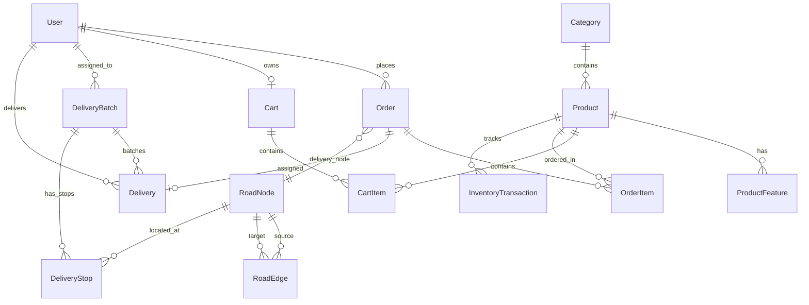

# Entity-Relationship Diagram (ERD)
### 14 Relational Models (Prisma ORM & PostgreSQL)

## Model Descriptions

1. **User**: Authentication, roles (CUSTOMER, ADMIN, COURIER), contact details.
2. **Category**: High-level catalog grouping (Electronics, Fashion, Grocery, Home Essentials).
3. **Product**: Core SKU data with NPR pricing and stock threshold levels.
4. **ProductFeature**: Attribute weights used for building high-dimensional vector embeddings for cosine similarity.
5. **InventoryTransaction**: Audit logging for all stock adjustments, sales, and returns.
6. **Cart & CartItem**: Active user shopping session state.
7. **Order & OrderItem**: Confirmed transactions created through atomic Prisma transactions.
8. **DeliveryBatch**: Multi-stop routing batches produced by the TSP optimization engine.
9. **Delivery**: Courier assignment link between Order and DeliveryBatch.
10. **DeliveryStop**: Sequenced drop-off points along the Butwal corridor.
11. **RoadNode**: 10 real Butwal road intersections (coordinates, depot vs intersection).
12. **RoadEdge**: Road network distances in kilometers connecting Butwal landmarks.
